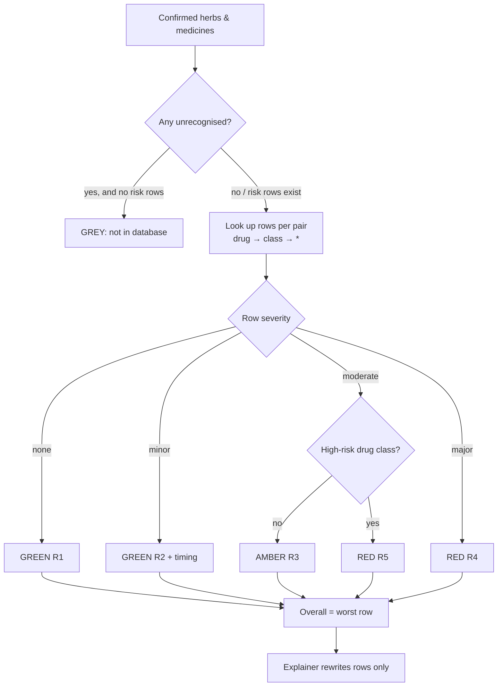

# Knowledge-base methodology

## Scope (v1.0.0)

- **Herbs / formulations (16):** ashwagandha, giloy (guduchi), guggul, turmeric (haridra), licorice (yashtimadhu),
  karela, methi, jamun, arjuna, brahmi, shankhpushpi, triphala, isabgol, tulsi, chyawanprash (as a product),
  bhasma (metal/mineral preparations, contamination class).
- **Medicines (34 generics, 16 classes)** with common Indian brand names: thyroid hormone, antidiabetic,
  anticoagulant, antiplatelet, statin, antihypertensive, diuretic, immunosuppressant, cardiac glycoside,
  benzodiazepine, SSRI, mood stabiliser, antiepileptic, corticosteroid, antibiotic, iron.
- **Interaction rows: 49**, each with ≥1 source.

Products (28) map branded Ayurvedic items to their constituent herbs so that "Himalaya Ashvagandha" or
"Dabur Chyawanprash" resolve to the right rows.

## Row schema

| Field | Meaning |
|---|---|
| `code` | Stable id shown on cards, e.g. `INT-GUGGUL-WARFARIN` |
| `herb_id` | The herb or formulation |
| `drug_id` **or** `drug_class` | Exactly one. `drug_class="*"` = any oral medicine (used for absorption/timing rows). A drug-specific row overrides a class row for the same herb. |
| `severity` | `minor` / `moderate` / `major` as judged from the cited evidence |
| `interaction_type` | `pharmacodynamic` / `pharmacokinetic` / `timing` / `contamination` |
| `mechanism`, `effect`, `management` | Written from the sources; management describes what the literature reports clinicians do, never an instruction to the patient |
| `timing_gap_hours` | Only when a source gives one |
| `evidence_grade` | A / B / C (below) |
| `population_flags` | e.g. pregnancy, CKD, transplant |
| `patient_summary_en/hi` | Human-written plain-language text used as the deterministic fallback |
| `sources[]` | title, type, DOI/PMID/URL, year, `verification_status` |
| `kb_version`, `reviewed_on`, `reviewer` | Provenance |

## Evidence grades

| Grade | Definition | Effect on verdict |
|---|---|---|
| A | Human RCT or systematic review / meta-analysis | None beyond severity |
| B | Case reports, case series, pharmacokinetic or small clinical studies | None beyond severity |
| C | Mechanistic, animal or in-vitro only | A non-timing row with only grade-C evidence is AMBER at most unless severity is major |

## Verdict rules (deterministic)

```
R1  no matching row, both entities recognised                → GREEN  "no known interaction in KB vX"
R2  severity = minor                                          → GREEN  (timing gap shown if present)
R3  severity = moderate, or grade C non-timing row            → AMBER
R4  severity = major                                          → RED
R5  severity = moderate AND drug class ∈ {anticoagulant,
    antiplatelet, immunosuppressant, cardiac_glycoside}
    AND type ∉ {timing, contamination}                        → RED  (escalation)

Overall = max over rows (RED > AMBER > GREEN).
If any input is unrecognised and no row is AMBER/RED        → GREY ("not in database"; never GREEN).
If there is no herb–medicine pair at all                     → GREY.
```



## Sources used

Peer-reviewed literature via PubMed (e.g. Gannon 2014 and Sharma 2018 on ashwagandha and thyroid indices;
Dalvi 1994 on guggul/propranolol–diltiazem; Nagral 2021 on herb-induced liver injury), NIH **LiverTox**, Memorial
Sloan Kettering **About Herbs**, **WHO Monographs on Selected Medicinal Plants**, **Stockley's Herbal Medicines
Interactions**, the **Ayurvedic Pharmacopoeia of India / PCIM&H**, Saper 2008 (JAMA) on heavy metals in
Ayurvedic products, and Indian pharmacovigilance publications.

## Citation policy

- A row with no source fails `validate_seed()` and is never loaded.
- Every source carries `verification_status`:
  - `needs_verification` — captured during the literature review; **this is the state of all v1.0.0 sources**.
  - `verified` — a team member re-opened the DOI/URL and confirmed it supports the row. Set by hand in
    `seed_data.py`, never by a model.
  - `disputed` — flagged by feedback; shown with a warning.
- `python scripts/verify_sources.py` prints the checklist. The home page and `/api/kb/stats` show the
  verified/total counts so the state is never hidden.
- No citation is fabricated. Where a claim rests on a monograph or database rather than a paper, the row cites
  that monograph's URL.

## Versioning

`KB_VERSION` is stamped on every row, result, PDF and the health endpoint. Changing rows means editing
`backend/app/db/seed_data.py` (reviewed in a PR), bumping the version, and re-running `scripts/seed.py`, which
replaces KB tables while keeping logs, ADR reports and feedback.

## Known gaps

- Coverage is a hackathon-scale demonstration (tens of rows), not a comprehensive reference.
- Product compositions are typical label constituents; batches vary.
- Contamination risk (heavy metals) is represented as a class-level row for bhasmas; it cannot be detected from
  a photo.
- Hindi OCR uses Tesseract's `hin` model (shipped in `backend/tessdata`) or the Groq vision model; Hindi/Devanagari
  synonyms are also in the dictionary so typed Hindi names resolve even when OCR misses them.
